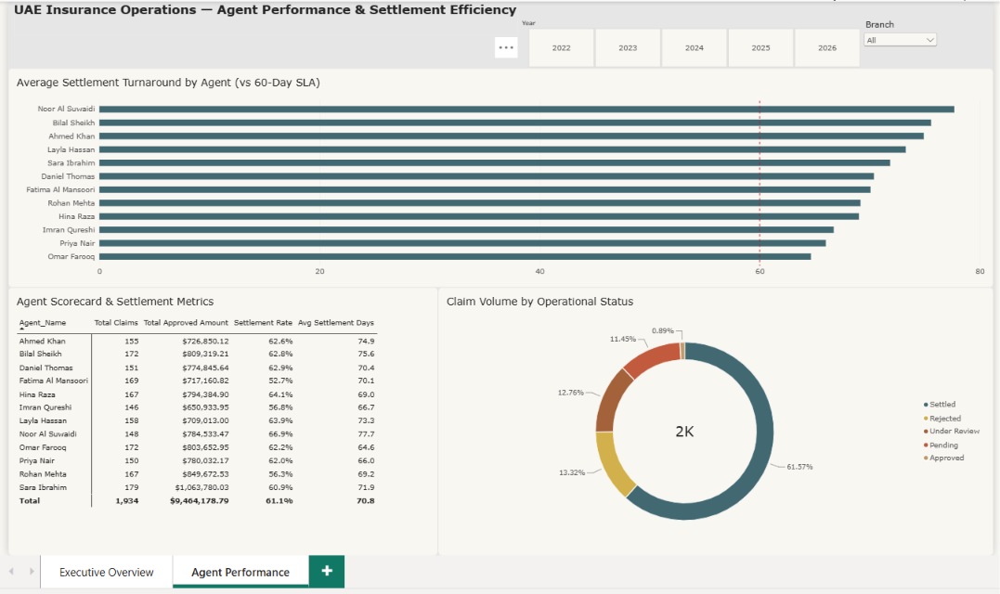

# Insurance Claims Analytics & Risk Management Dashboard

An executive-level Power BI reporting solution designed for insurance underwriters, claims managers, and risk analysts to monitor claim settlement velocity, loss ratios, reserve adequacy, and fraud detection indicators.

---

## 📊 Dashboard Preview


---

## 🎯 Key Business Problems Solved
- **Loss Ratio & Solvency Tracking:** Analyze pure loss ratios vs. earned premium across policy types (Auto, Health, Property, Commercial).
- **Claim Settlement Velocity:** Monitor Turnaround Time (TAT) from First Notice of Loss (FNOL) to claim settlement.
- **Exposure & Fraud Anomalies:** Identify suspicious claim spikes, repeat claimant flags, and regional loss clusters.
- **Underwriting Feedback Loop:** Quantify which risk segments generate unhedged claims to recalibrate premium rates.

---

## 🛠️ Data Architecture & DAX Modeling
- **Data Modeling:** Star Schema with `Fact_Claims` and `Fact_Policies` connected to conformed dimensions (`Dim_Policyholder`, `Dim_PolicyType`, `Dim_Geography`, `Dim_Date`).
- **Core DAX Measures:**
  - `Loss Ratio = DIVIDE([Total Claim Payouts], [Total Earned Premium], 0)`
  - `Average Cycle Time (Days) = AVERAGEX(Fact_Claims, Fact_Claims[SettlementDate] - Fact_Claims[NoticeDate])`
  - `Incurred But Not Reported (IBNR) Reserve Pacing`
  - `Claim Frequency & Severity Ratios`

---

## 🚀 How to Run Locally
1. Clone this repository:
   ```bash
   git clone [https://github.com/Gulfam-110/Insurance-Claims-Analytics-PowerBI.git](https://github.com/Gulfam-110/Insurance-Claims-Analytics-PowerBI.git)# Insurance-Claims-Analytics-PowerBI
End-to-end Power BI claims analytics suite tracking loss ratios, fraud patterns, claim settlement velocity, and underwriting risk metrics.
